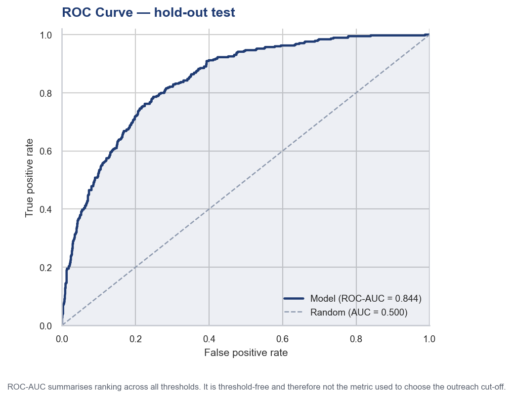
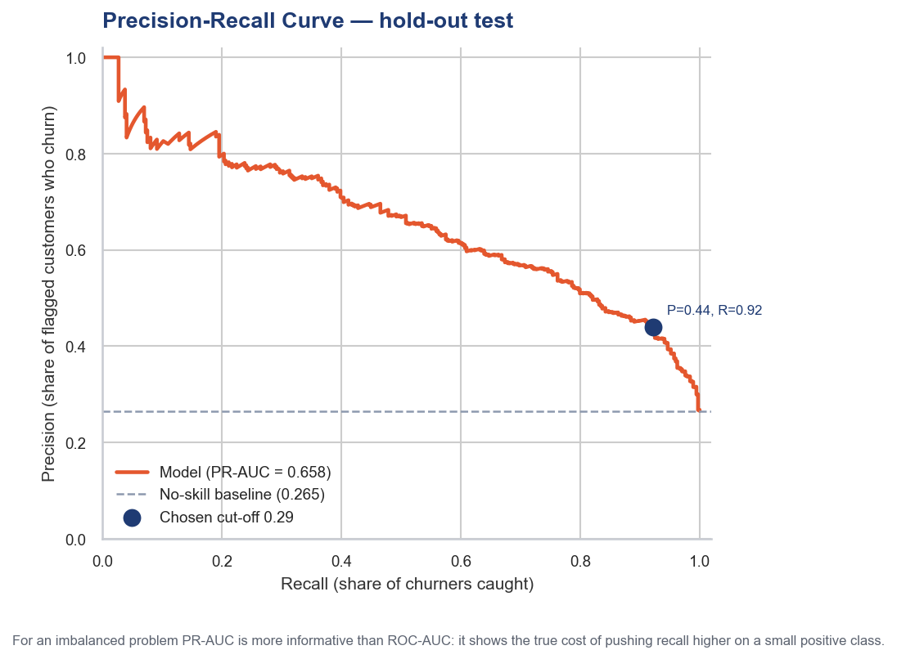
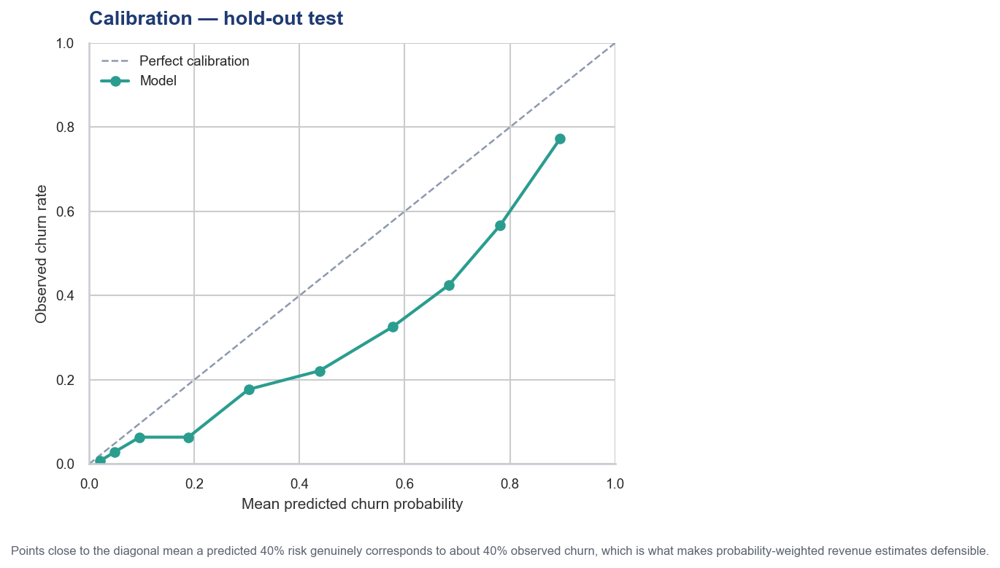
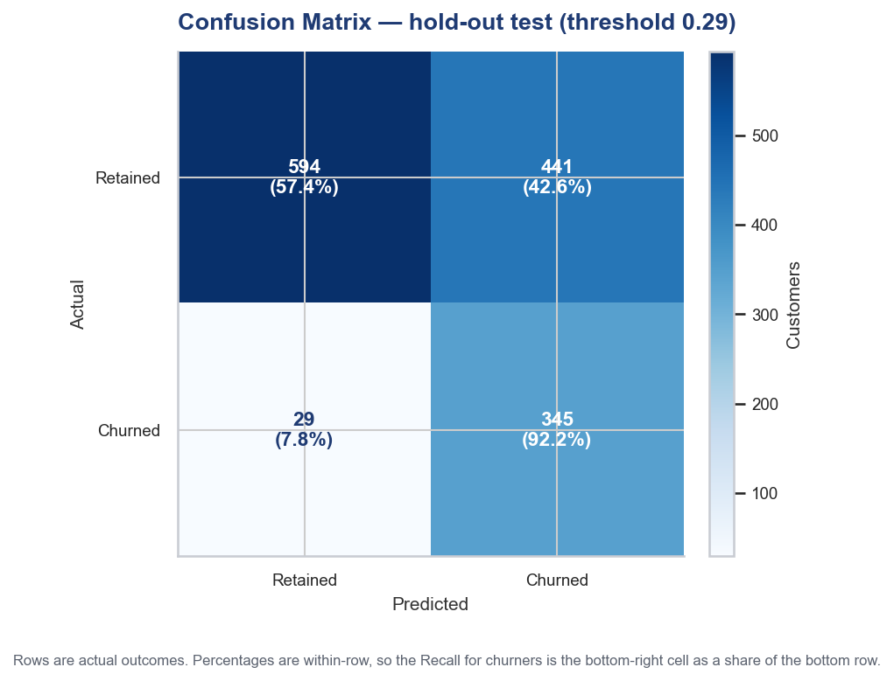
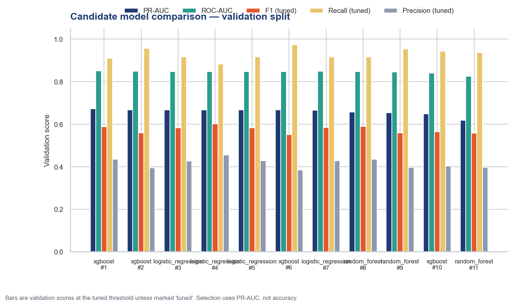

# Model Evaluation Report

**Generated:** 2026-11-19 15:25 UTC
**Selected model:** `xgboost` with `{"n_estimators": 200, "max_depth": 3, "learning_rate": 0.05, "subsample": 0.9}`
**Decision threshold:** 0.293 (chosen by maximising F2 on the validation split)
**Selection metric:** PR-AUC (average precision)
**Seed:** 42

All figures below are computed on the **hold-out test set**, which was never used
for fitting, hyper-parameter selection or threshold selection.

```
train      : 4,507 rows   churn 26.54%
validation : 1,127 rows   churn 26.53%
test       : 1,409 rows   churn 26.54%
```

---

## 1. Why PR-AUC drives the decision

Churn is a 26.5% minority class. A model that predicts
"nobody churns" reaches 73.5% accuracy and is
completely useless. Accuracy therefore cannot be the selection criterion.

The business decision is a **ranked outreach list with finite capacity**. What
matters is whether the customers at the top of the list churn more often than the
base rate — that is exactly what PR-AUC and lift measure. ROC-AUC is reported for
completeness but rewards performance on a negative class the business already
handles fine.

---

## 2. Candidate comparison (validation split)

| model | params | val_accuracy_at_0.5 | val_precision_at_0.5 | val_recall_at_0.5 | val_f1_at_0.5 | val_roc_auc | val_pr_auc | tuned_threshold | val_precision_tuned | val_recall_tuned | val_f1_tuned | val_f2_tuned |
|---|---|---|---|---|---|---|---|---|---|---|---|---|
| xgboost | {"learning_rate": 0.05, "max_depth": 3, "n_estimators": 200, "subsample": 0.9} | 0.7542 | 0.5243 | 0.7926 | 0.6312 | 0.8515 | 0.6724 | 0.293 | 0.4352 | 0.9097 | 0.5887 | 0.7468 |
| xgboost | {"learning_rate": 0.05, "max_depth": 3, "n_estimators": 400, "subsample": 0.9} | 0.7569 | 0.5285 | 0.7759 | 0.6287 | 0.8492 | 0.668 | 0.181 | 0.395 | 0.9565 | 0.5591 | 0.7448 |
| logistic_regression | {"C": 1.0, "solver": "liblinear"} | 0.7542 | 0.5241 | 0.7993 | 0.6331 | 0.8483 | 0.6679 | 0.308 | 0.4268 | 0.9164 | 0.5824 | 0.7454 |
| logistic_regression | {"C": 0.1, "solver": "liblinear"} | 0.756 | 0.5264 | 0.7993 | 0.6348 | 0.8478 | 0.6673 | 0.379 | 0.456 | 0.8829 | 0.6014 | 0.7437 |
| logistic_regression | {"C": 1.0, "solver": "lbfgs"} | 0.7542 | 0.5241 | 0.7993 | 0.6331 | 0.8483 | 0.6672 | 0.311 | 0.4275 | 0.9164 | 0.583 | 0.7458 |
| xgboost | {"learning_rate": 0.03, "max_depth": 4, "n_estimators": 400, "subsample": 0.9} | 0.7587 | 0.531 | 0.7726 | 0.6294 | 0.848 | 0.6672 | 0.143 | 0.3849 | 0.9732 | 0.5517 | 0.7454 |
| logistic_regression | {"C": 3.0, "solver": "lbfgs"} | 0.7533 | 0.5231 | 0.796 | 0.6313 | 0.8485 | 0.6665 | 0.31 | 0.4288 | 0.9164 | 0.5842 | 0.7466 |
| random_forest | {"max_depth": 6, "min_samples_leaf": 5, "n_estimators": 300} | 0.7516 | 0.5212 | 0.7826 | 0.6257 | 0.8481 | 0.6569 | 0.316 | 0.4349 | 0.9164 | 0.5899 | 0.7503 |
| random_forest | {"max_depth": 10, "min_samples_leaf": 3, "n_estimators": 300} | 0.7773 | 0.5612 | 0.7358 | 0.6368 | 0.8454 | 0.6536 | 0.176 | 0.3964 | 0.9532 | 0.5599 | 0.7441 |
| xgboost | {"learning_rate": 0.05, "max_depth": 5, "n_estimators": 300, "subsample": 0.8} | 0.7657 | 0.5428 | 0.7425 | 0.6271 | 0.8414 | 0.6483 | 0.151 | 0.4029 | 0.9431 | 0.5646 | 0.7437 |
| random_forest | {"max_depth": null, "min_samples_leaf": 1, "n_estimators": 500} | 0.7968 | 0.6699 | 0.4615 | 0.5465 | 0.826 | 0.6192 | 0.102 | 0.3966 | 0.9365 | 0.5572 | 0.7361 |

The winner is the row with the highest `val_pr_auc`. Note that the accuracy column
is nearly flat across candidates: accuracy hides almost all of the real difference
between these models, which is the point being made above.

---

## 3. Final model — test-set metrics

### At the default 0.5 cut-off

| Metric | Score |
|---|---|
| Accuracy | 0.7509 |
| Precision | 0.5202 |
| Recall | 0.7914 |
| F1-score | 0.6278 |
| F2-score | 0.7167 |
| ROC-AUC | 0.8438 |
| PR-AUC (average precision) | 0.6583 |


### At the tuned cut-off (0.293)

| Metric | Score |
|---|---|
| Accuracy | 0.6664 |
| Precision | 0.4389 |
| Recall | 0.9225 |
| F1-score | 0.5948 |
| F2-score | 0.7559 |
| ROC-AUC | 0.8438 |
| PR-AUC (average precision) | 0.6583 |


### Confusion matrix at the default 0.5 cut-off

|  | Predicted Retained | Predicted Churned |
|---|---|---|
| **Actual Retained** | 762 (TN) | 273 (FP) |
| **Actual Churned** | 78 (FN) | 296 (TP) |


### Confusion matrix at the tuned cut-off

|  | Predicted Retained | Predicted Churned |
|---|---|---|
| **Actual Retained** | 594 (TN) | 441 (FP) |
| **Actual Churned** | 29 (FN) | 345 (TP) |


Interpretation of the trade-off, in business terms:

- At 0.5 the model catches **296 of 374** churners
  (**79.1% recall**) while flagging **273** customers who stay
  (**52.0% precision**).
- At 0.293 it catches **345 of 374**
  (**92.2% recall**), flagging **441** false alarms
  (**43.9% precision**).
- Moving to the tuned cut-off changes the missed-churner count from
  **78 to 29** and the false-alarm count from **273 to 441**.
  Every extra churner caught costs additional wasted contacts; the F2
  threshold deliberately accepts that trade because missing a churner who pays recurring
  monthly charges is usually more expensive than one unnecessary retention call.

**The honest caveat:** without campaign cost data and a measured save rate, no
dollar-optimal threshold can be computed. The F2 cut-off is a
defensible operating point, not a proven optimum.

---

## 4. Classification report — default threshold

```
              precision    recall  f1-score   support

    Retained      0.907     0.736     0.813      1035
     Churned      0.520     0.791     0.628       374

    accuracy                          0.751      1409
   macro avg      0.714     0.764     0.720      1409
weighted avg      0.804     0.751     0.764      1409

```

## 5. Classification report — tuned threshold

```
              precision    recall  f1-score   support

    Retained      0.953     0.574     0.717      1035
     Churned      0.439     0.922     0.595       374

    accuracy                          0.666      1409
   macro avg      0.696     0.748     0.656      1409
weighted avg      0.817     0.666     0.684      1409

```

---

## 6. Curves

### ROC curve


### Precision-recall curve


### Calibration


### Confusion matrix


### Candidate comparison


---

## 7. Methodology and leakage controls

1. **Identifier excluded.** `customer_id` is never a feature.
2. **Label-derived columns excluded.** `churn`, `churn_label` and any column whose
   name contains churn/target/outcome/label are blocked by an explicit assertion.
3. **No target encoding on the full dataset.** The one-hot vocabulary and the
   scaler are fitted inside the pipeline, on training rows only.
4. **Stratified splits.** Churn rate is held constant across train/validation/test.
5. **Overlap check.** The pipeline asserts that no customer appears in both train
   and test.
6. **Imbalance handled inside training.** Logistic Regression uses
   `class_weight='balanced'`, Random Forest `class_weight='balanced_subsample'`,
   XGBoost `scale_pos_weight` computed from the training split only.
7. **Threshold selected on validation**, then applied unchanged to test.
8. **Final refit on train + validation**, with the test set held out for the single
   evaluation reported above.

---

## 8. Limitations

- The dataset is a **fictional, single-snapshot sample**; these metrics describe the
  sample, not a production population.
- No temporal validation is possible: there are no dates, so performance cannot be
  assessed for drift over time.
- No campaign cost, save-rate or contact-capacity economics exist in the data, so
  the threshold is a business judgement rather than an optimisation result.
- Perfect separation is impossible here: some churn is driven by factors absent from
  the data (competitor offers, service outages, relocation).
